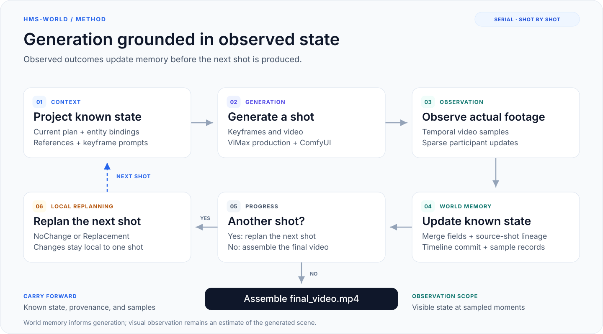

# hms-world: Evolving World Memory for Multi-Shot Video Generation

[English](README.md) · [简体中文](README.zh-CN.md) · [Documentation](docs/README.md)

**World memory for multi-shot video generation.** hms-world observes generated footage, maintains structured world state, and uses that memory to guide visual reference selection, keyframe prompting, and next-shot replanning.

[News](#news) · [Highlights](#highlights) · [Overview](#overview) · [Core Codes](#core-codes) · [Quick Start](#quick-start) · [Results](#benchmark-results) · [TODO](#todo)

<a id="news"></a>

## 🔥 News

* **`2026.11.05`** 🤗 We release **hms-world**, a world-memory framework for multi-shot video generation, with **CLI, Web, and TUI** workflows, a [three-shot example](examples/serial_demo_three_shot.txt), and [historical benchmark results](#benchmark-results).
* **`2026.10.29`** ✅ ViMax baseline scoring completed for **4/35 stories (42 shots)**. [Matched-story results and metadata](evals/results/vimax-baseline-partial-20261029.json) are available.
* **`2026.10.22`** ✅ Historical development-run scoring completed on **35 stories / 437 shots** of **ViMax-Bench**. See the [per-story scores and experimental conditions](evals/results/vimax-bench-20261022.json).

<a id="highlights"></a>

## 🎯 Highlights

- **Evolving World Memory:** Maintain character, prop, and scene state on a unified Timeline with stable entity IDs.
- **Observation-Driven Updates:** Extract sparse state changes from actual generated footage and merge them into known state.
- **Provenance-Guided References:** Connect state fields to historical shots and select relevant visual materials for keyframe generation.
- **Local Next-Shot Replanning:** Retain or revise the next shot using observed outcomes and camera constraints.
- **Unified Workflows:** Share serial production across CLI, Web, TUI, and evaluation, with plan review and checkpoint recovery.

🌟 **Built on ViMax:** hms-world extends [ViMax](https://github.com/HKUDS/ViMax)'s portraits, storyboards, camera transitions, and shot production with a persistent observation–memory–generation loop.

<a id="abstract"></a>
<a id="overview"></a>

## ✨ Overview

<p align="center">
  <a href="docs/diagrams.md#generation-loop">
    
  </a>
</p>

> **TLDR:** hms-world builds world memory from generated footage and carries observed state into subsequent shots through reference selection, keyframe prompts, and local replanning.

[Full-size figure](docs/assets/world-memory-loop.svg) · [System architecture](docs/diagrams.md#system-architecture) · [Continuity documentation](docs/continuity.md)

A screenplay specifies intended actions; the generated video determines what is visible. If a character is still holding a cup after a planned placement, later shots need that observed state to judge whether the next plan remains appropriate. hms-world separates narrative intent from visual observation and connects successive shots through updated memory.

<details>
<summary><strong>🎬 Video demo (click to expand)</strong></summary>

https://github.com/user-attachments/assets/e0079784-4056-43c4-aa20-bb1d985bc648

</details>

<a id="method"></a>

<details>
<summary><strong>Method details: state, observation, retrieval, and replanning (click to expand)</strong></summary>

### 1. Entity state and a unified timeline

The entity registry assigns stable IDs to characters, props, and scenes. The Timeline organizes shots in story order: pending positions contain plans, while observed positions contain complete snapshots of accumulated known state. Before executing a shot, the system projects prior known state onto its participating entities.

Character state includes outfit, expression, emotion, pose, position, orientation, and held registered props. Prop state includes position and physical condition; scene state records visible layout and changes. Camera state belongs to the current shot and is not inherited by the next shot.

### 2. Visual observation and sparse state merging

The Observer reads a 3×4 board of entity references and temporal samples, with up to two optional rounds of original-size sample inspection. It reports observed state at the last sampled moment, restricted to the current shot's participants. The Observer does not receive the action plan; the Replanner performs the subsequent comparison of planned and observed outcomes.

| Update | Merge semantics |
| --- | --- |
| Omitted field | Preserve the prior known value |
| Explicit `null` field | Clear the prior value and its provenance |
| `holding: []` | Confirm that no in-scope registered prop is held, replacing the prior list |
| Non-null field value | Write the value; update provenance when the value changes |

Entities outside the current shot retain their known state. The model provides local observations, while the Timeline maintains accumulated state.

### 3. Field provenance and historical visual materials

For non-null fields established through observation, the system records the shot where a value first appeared or most recently changed. Unchanged values retain their source; cleared fields lose their source. This index connects structured memory to historical video samples.

The current candidate construction path uses **field provenance for props explicitly bound to the current shot** to locate historical shots. Each source shot contributes its last sample and one reproducibly selected random sample. The Selector combines these candidates with identity portraits and ViMax's native camera references for the current first- or last-frame endpoint. It selects one portrait per visible character; last-frame generation additionally requires the current shot's actual first frame. The FramePromptWriter combines selected materials, the current target, and known state into the final keyframe prompt.

Provenance identifies a source shot. Whether a particular sample supports a field value still depends on its visible content. Historical images contribute only continuity information that is visible and relevant to the current task.

### 4. Next-shot replanning from observed outcomes

The Replanner receives the previous shot's script, complete merged known state, its last actual sampled frame, and the next shot's plan and camera constraints. It returns `NoChange` or `Replacement`, with changes restricted to the next shot. A revised plan follows the same reference selection, generation, and observation process.

See [continuity state and visual materials](docs/continuity.md) for state models, provenance, selection, and recovery semantics.

</details>

<a id="core-codes"></a>

## 💥 Core Codes and Supported Backends

The serial production loop is implemented in [`pipelines/serial_demo_pipeline.py`](pipelines/serial_demo_pipeline.py). Its main components are:

| Component | Implementation |
| --- | --- |
| Serial production and recovery | [`pipelines/serial_demo_pipeline.py`](pipelines/serial_demo_pipeline.py) |
| Timeline and state merging | [`continuity/timeline.py`](continuity/timeline.py) |
| Visual observation | [`agents/shot_observer.py`](agents/shot_observer.py) |
| Continuity reference selection | [`agents/continuity_image_retriever.py`](agents/continuity_image_retriever.py) |
| Keyframe prompt construction | [`agents/frame_prompt_writer.py`](agents/frame_prompt_writer.py) |
| Next-shot replanning | [`agents/shot_replanner.py`](agents/shot_replanner.py) |
| Interactive runtime | [`agent_runtime/`](agent_runtime) |
| Benchmark generation and scoring | [`evals/vimax/`](evals/vimax) |

The repository provides ComfyUI [FLUX](tools/image_generator_comfy_flux.py) and [Qwen](tools/image_generator_comfy_qwen.py) image adapters and an [H3 video adapter](tools/video_generator_comfy_h3.py). Conversation and visual understanding use OpenAI-compatible interfaces.

### Default configuration

The current example generation configuration and scoring settings are listed below. Historical generation conditions are documented in the corresponding result files.

| Component | Model / service | Settings |
| --- | --- | --- |
| Conversation, planning, and visual understanding | Qwen3-VL-30B-A3B | temperature 0.7, top_p 0.8, max_tokens 8192 |
| Image generation | ComfyUI FLUX.2 klein 9B Base | 50 steps, CFG 4.0 |
| Video generation | ComfyUI H3 | 1280×720, 5 seconds, first-frame or first/last-frame conditioning |
| Consistency scoring | ViCLIP-L-14 / InternVid-10M-FLT | 8 frames, 224×224, float32 |

Visual style is task-specific; the reported runs used `realistic live action`. Configure service endpoints and the H3 workflow path in the [serial example configuration](configs/serial_demo_local_h3.example.yaml).

<a id="architecture"></a>

<details>
<summary><strong>Architecture, outputs, and checkpoint recovery (click to expand)</strong></summary>

The system comprises a Python production core, Web/TUI interaction layers, and file-based checkpoints. All entry points share serial production: each shot completes generation, observation, and state commit before the next shot proceeds.

[View the system architecture diagram →](docs/diagrams.md#system-architecture)

The Web service and TUI exchange JSONL events with a Python Agent subprocess; Web forwards progress to the browser through SSE. Conversation and visual understanding use OpenAI-compatible model interfaces, with generation services accessed through loopback endpoints.

Each run saves entity registrations, `continuity/timeline.json`, image records, per-shot media, and sample manifests. Recovery validates checkpoints against actual files before continuing. Interactive workflows support text-plan review before rendering; revisions create a new session while preserving the original plan and media. See [serial generation architecture](docs/architecture.md) for outputs and recovery details.

</details>

<a id="installation"></a>
<a id="preparation"></a>

## 🛠 Preparation

Requirements: **Python 3.12+**, **uv**, and **FFmpeg**. Web/TUI additionally require Node.js and npm; Node.js 22 is recommended.

**1. Clone the repository and install Python dependencies.**

```sh
git clone https://github.com/Shadow-Weave/HMS-World.git hms-world
cd hms-world
uv sync --locked --python 3.12
```

Run all subsequent commands from the repository root.

**2. Configure local inference services.**

```sh
cp configs/serial_demo_local_h3.example.yaml configs/serial_demo_local_h3.yaml
```

Deploy a vision-capable OpenAI-compatible model service, a ComfyUI image service, and a ComfyUI H3 video service separately. Update the configuration for your deployment:

| Field | Purpose |
| --- | --- |
| `chat_model.init_args` | Vision-capable model name, endpoint, and credentials |
| `image_generator.init_args.base_url` | ComfyUI image endpoint; the example uses FLUX.2 klein |
| `video_generator.init_args.base_url` | ComfyUI H3 video endpoint |
| `video_generator.init_args.workflow_path` | Actual local path to the H3 API workflow JSON |

> **💡 Configuration:** Keep `local_only: true` and use loopback endpoints. Remote services can be accessed through SSH forwarding. Replace `/path/to/workflow-api.json` before running.

**3. Prepare the interactive configuration (for Web/TUI).**

```sh
cp configs/agent.example.yaml configs/agent.local.yaml
```

Set `serial.config` to the same serial YAML, or use `HMS_WORLD_SERIAL_CONFIG`. Conversation defaults to its `chat_model`; optional `llm` settings override only the conversation model. Image, video, and continuity components use the serial configuration.

<a id="quick-start"></a>

## 🎬 Quick Start

### Serial three-shot generation

```sh
.venv/bin/python main_serial_demo.py \
  --config configs/serial_demo_local_h3.yaml \
  --script-file examples/serial_demo_three_shot.txt \
  --user-requirement-file examples/serial_demo_three_shot_requirements.txt \
  --style "3D CGI animation" \
  --output .working_dir/serial_demo
```

Outputs are saved under `.working_dir/serial_demo/`, with the Timeline checkpoint at `continuity/timeline.json`. A successful run prints the assembled video's path.

<details>
<summary><strong>Resume an existing production run (click to expand)</strong></summary>

Use the original configuration, style, and output directory. Add `--resume` and omit script and requirements inputs.

```sh
.venv/bin/python main_serial_demo.py \
  --config configs/serial_demo_local_h3.yaml \
  --style "3D CGI animation" \
  --resume \
  --output .working_dir/serial_demo
```

</details>

### Web workspace

```sh
npm --prefix web ci
./hms-world web
```

Open `http://127.0.0.1:4173`. The interface supports sessions, uploads, shot and media previews, rendering progress, and serial configuration. See the [Web guide](web/README.md) for build and server options.

### Terminal interface

```sh
npm --prefix ui ci
./hms-world tui
```

<details>
<summary><strong>Interactive planning and session commands (click to expand)</strong></summary>

Planning saves reviewable text and a Timeline before media generation. Rendering resumes from that Timeline under `.working_dir/<session_id>/serial/`. Revisions create a new session and preserve the original plan and media.

```sh
# Create a session
./hms-world tui new
# Resume a specific session
./hms-world tui resume <session_id>
```

Legacy Idea/Novel/Script sessions remain viewable; start a new serial session with the approved story text to render them again. Project environment variables use the `HMS_WORLD_*` prefix.

</details>

<a id="evaluation"></a>

## 🚀 Evaluation

Inspect the bundled **ViMax-Bench** dataset without calling model providers:

```sh
.venv/bin/python evals/vimax/runner.py --list
.venv/bin/python evals/vimax/runner.py 29 --validate-only
```

After configuring the generation services, run a benchmark story through the shared serial pipeline:

```sh
.venv/bin/python evals/vimax/runner.py 29 --execute
```

See the [evaluation guide](evals/README.md) for batch generation, resume, and scoring. ViCLIP scoring requires a separately prepared model and runtime. Development checks are listed in the [development guide](docs/development.md).

<a id="benchmark-results"></a>

## 📊 Benchmark Results

### Evaluation protocol

ViMax-Bench contains **35 stories and 437 shots**. The current adapter uses the dataset's `first_frame` and `video_prompt` as shot-level inputs to the shared production pipeline. An independent entry point computes consistency scores; see the [evaluation guide](evals/README.md) for adaptation and execution details.

Scoring uses cosine similarity between **ViCLIP-L-14 / InternVid-10M-FLT** video features. Each shot contributes 8 frames resized to 224×224 with RGB ImageNet normalization. Scene groups follow the dataset's original `scene_num` values.

| Metric | Definition |
| --- | --- |
| IC ↑ | Mean similarity between distinct shot pairs within the same official scene |
| CC ↑ | Mean similarity between shot pairs from different official scenes |
| GC ↑ | Mean similarity across all distinct shot pairs |

All metrics exclude self-pairs. Scores are computed per story and then averaged with equal story weights; tables report four decimal places. These metrics measure visual similarity. Action completion, physical state correctness, and narrative quality require separate evaluation.

### Complete historical development run

The following results were scored on **October 20–22, 2026**. This development run included external visual review before each shot video, retries, prompt and code adjustments, and some case restarts. Image generation migrated from Qwen to FLUX during the run, retaining completed outputs. The table describes that historical development process; the current code and default configuration have not been rerun across all 35 stories.

| Group | Stories | IC ↑ | CC ↑ | GC ↑ |
| --- | ---: | ---: | ---: | ---: |
| **Overall** | **35** | **0.6264** | **0.6075** | **0.6132** |
| Type A | 12 | 0.5077 | 0.4853 | 0.4902 |
| Type B | 12 | 0.7135 | 0.7152 | 0.7152 |
| Type C | 11 | 0.6608 | 0.6231 | 0.6360 |
| Medium (2 scenes) | 12 | 0.6374 | 0.6130 | 0.6238 |
| Long (3–4 scenes) | 23 | 0.6206 | 0.6046 | 0.6076 |

The [per-story scores and evaluation metadata](evals/results/vimax-bench-20261022.json) include the scoring source revision, weights SHA256, model migration record, and aggregation protocol. The public export contains scores and metadata; original videos and full run logs are not included. See [`score.py`](evals/vimax/score.py) for the scoring implementation.

### ViMax baseline: matched-story subset

The baseline has completed **4/35 stories**, scored on **October 29, 2026**: cases **1, 13, 17, and 19**, totaling **42 shots** (one Type A story and three Type B stories).

It uses ViMax's native planning and production pipeline at upstream revision `fd4b72e`, with local model adapters and without hms-world's Observer, Timeline continuity loop, or Replanner. Official story descriptions and shot prompts are supplied to native planning. Scoring uses the same ViCLIP settings and original `scene_num` groups.

The table compares **the same four stories**, using hms-world outputs from the historical development run above. Both rows use equal story weights.

| Method | Stories compared | IC ↑ | CC ↑ | GC ↑ |
| --- | ---: | ---: | ---: | ---: |
| ViMax baseline (partial) | 4 | 0.6798 | 0.6812 | 0.6807 |
| hms-world (same cases) | 4 | 0.6888 | 0.6951 | 0.6927 |

| Case | Type | Baseline GC ↑ | hms-world GC ↑ |
| --- | --- | ---: | ---: |
| 1 · chef_international_kitchens | Type A | 0.5884 | 0.5804 |
| 13 · investigation_antique_bookshop | Type B | 0.7324 | 0.7397 |
| 17 · family_gathering_victorian_mansion | Type B | 0.6794 | 0.7244 |
| 19 · science_demo_university_lab | Type B | 0.7228 | 0.7262 |

The two sets of outputs come from separate historical runs with differences in generation and review conditions. Findings are limited to the completed subset. A full 35-story baseline under matched conditions, single-variable ablations, and repeated-seed confidence intervals have not been reported. The [partial baseline export](evals/results/vimax-baseline-partial-20261029.json) provides complete IC, CC, GC, and upstream provenance.

<a id="todo"></a>

## 📋 TODO

Completed capabilities and open research directions are tracked below. Unchecked items describe planned work.

- [x] Serial observation, Timeline state updates, field provenance, and next-shot replanning.
- [x] Shared CLI/Web/TUI production with plan review and checkpoint recovery.
- [x] ViMax-Bench adaptation, consistency scoring, and historical result exports.
- [ ] Complete the 35-story baseline under matched generation and review conditions.
- [ ] Rerun the current release with one fixed model configuration.
- [ ] Add repeated-seed trials, confidence intervals, and controlled ablations of observation, retrieval, and replanning.
- [ ] Evaluate action completion and physical state correctness alongside visual similarity.
- [ ] Extend historical retrieval and indexing for longer narratives.
- [ ] Investigate automatic retakes and replanning across multiple shots.

<a id="limitations"></a>

## 📝 Limitations

- **Observation reliability:** The Observer may misinterpret footage, and sparse sampling may miss brief changes. Field provenance supports traceability; state accuracy still depends on visual observation.
- **Generation control:** References and structured state do not guarantee adherence to constraints. Duplicate characters, incorrect spatial relationships, and interference from historical compositions remain possible.
- **Historical access:** Current candidate construction relies on provenance for explicitly bound props. Arbitrary earlier-narrative retrieval and large-scale history indexing are not implemented.
- **Planning scope:** The Replanner affects only the next shot. Automatic retakes and multi-shot propagation are not implemented.
- **Experimental coverage:** Development interventions, a partial baseline, and the absence of repeated trials limit attribution and generalization. Further evaluation requires complete matched conditions and separate measures of action, state, and narrative quality.

<a id="acknowledgments"></a>

## 👍 Acknowledgments

hms-world builds on [HKUDS/ViMax](https://github.com/HKUDS/ViMax), retaining its character portraits, storyboards, camera transitions, and shot production with corresponding upstream attribution. The project's main extensions are serial visual observation, world-state memory, historical material selection, and next-shot replanning.

We acknowledge the upstream project and the open-source models and tools used in this system.

<a id="license"></a>

## 📄 License

The code is released under the [MIT License](LICENSE), preserving the original license notice.
