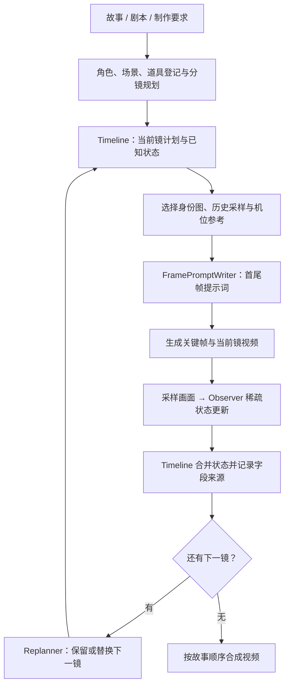
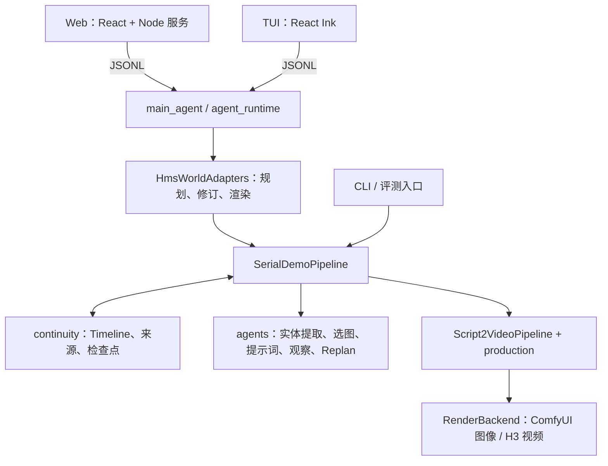

# hms-world：面向视频生成的世界记忆

[English guide](README.en.md)

**从画面中形成记忆，用记忆支撑后续生成。**

hms-world 为多镜头视频生成维护一份随画面演进的**世界记忆（world memory）**：人物手里还拿着什么、道具被放到了哪里、场景发生了哪些变化。系统将这些信息保存为可更新的状态，记录状态的来源，并保留可回看的历史画面。后续镜头从这份记忆中读取相关上下文，用于选择参考图、编写绘图提示词和调整计划。

项目的核心是记忆的**表示、写入、更新与读取**。我们将这套机制接入 [ViMax](https://github.com/HKUDS/ViMax) 的视频生成流程：ViMax 提供角色图、分镜、机位转场和单镜制作能力；hms-world 负责积累生成过程中的已知状态，并把相关记忆带回后续生成。跨镜头连续性是这套记忆机制的应用目标。

[我们的改动](#我们做了什么) · [核心方案](#连续性闭环怎么工作) · [系统架构](#系统架构) · [Bench 分数](#benchmark-结果) · [安装运行](#安装) · [Web / TUI](#使用-web-或终端界面) · [文档索引](docs/README.md)

## 我们做了什么

https://github.com/user-attachments/assets/e0079784-4056-43c4-aa20-bb1d985bc648

多镜头生成需要同时处理身份、动作和状态的延续。例如，上一镜要求人物把杯子放到桌上，实际视频却仍然让人物拿着杯子，下一镜的制作就需要知道这个偏差。剧本提供目标，实际画面提供已经发生的事实。

我们保留 ViMax 的角色图、分镜拆解、机位转场和单镜制作能力，并加入以下机制：

| 改动 | 作用 |
| --- | --- |
| **按故事顺序逐镜执行** | 每镜完成生成、观察和状态合并后，再推进下一镜 |
| **Observer + 单一 Timeline** | 从实际视频提取稀疏状态更新，统一保存已知状态和待执行计划 |
| **字段来源与历史视觉材料** | 记录状态在哪一镜形成或改变，据此寻找可复用的历史采样画面 |
| **参考图选择与 FramePromptWriter** | 为当前首帧或尾帧选择身份图、历史材料和机位参考，再写最终绘图提示词 |
| **下一镜 Replanner** | 根据实际终态决定保留或替换下一镜方案 |
| **统一的交互与恢复入口** | CLI、Web、TUI 共用生产实现；支持文本审阅、计划修订和检查点续跑 |
| **评测适配** | 接入 ViMax-Bench 的既定分镜、逐镜生成与一致性评分 |

## 连续性闭环怎么工作



### 1. 将计划与实际状态放在同一条时间轴上

实体登记为人物、道具和场景分配稳定 ID。Timeline 中的镜头按故事顺序排列，未执行位置保存计划，已观察位置保存合并后的完整已知状态。执行当前镜前，系统将此前状态投影到本镜参与的实体上。

人物状态包括服装、表情、姿势、位置、朝向和持有的登记道具；道具记录位置与状态；场景记录可见布置与状态。机位信息只属于当前镜，不自动沿用上一镜。

### 2. 观察实际视频，逐字段合并

Observer 读取由实体参考和时序采样组成的 3×4 图板，必要时可请求原尺寸采样帧补看，最多两轮。它记录实际过程在末次采样时刻的状态，只输出本镜参与实体的稀疏更新。

Timeline 负责合并：省略字段保留旧值，显式 `null` 清除旧值，`holding: []` 表示确认没有持有本镜登记道具。未参与本镜的实体继续保留其已知状态。Observer 不读取动作计划，也不承担计划与实际结果的比较。

### 3. 把状态来源接回可用的参考画面

每个非空状态字段记录其首次出现或最近变化的镜头编号。字段值未变时保留原来源；被清空时移除来源。

当前选图路径用**本镜绑定道具的字段来源**定位历史镜头，为每个来源镜头提供末张采样和一张可复现的随机采样。Selector 结合这些候选、人物身份图及原生机位参考，为当前端点选择材料。每个可见人物选一张身份图；生成尾帧时，本镜实际首帧是必需材料。

字段来源定位到镜头，不代表该镜头的任意一张采样都能证明字段值。历史图只用于画面中可见且相关的连续性。FramePromptWriter 结合当前目标、已知状态及选中的图片，输出最终绘图提示词。

### 4. 用实际结果调整下一镜

Replanner 读取上一镜剧本、合并后的完整已知状态和上一镜最后一张实际采样图，返回 `NoChange` 或 `Replacement`。调整范围限定为下一镜。修改后的计划继续经过同一套选图、生成和观察流程。

详细的状态语义、材料选择和恢复规则见[连续性状态与视觉材料](docs/continuity.md)。

## 系统架构

项目采用 Python 生产核心、Web/TUI 交互层和文件检查点。各入口共享串行制作流程。



| 模块 | 职责 |
| --- | --- |
| [`agent_runtime/`](agent_runtime) | 对话、工具调用、上下文压缩、会话与制作请求适配 |
| [`pipelines/serial_demo_pipeline.py`](pipelines/serial_demo_pipeline.py) | 串行执行、观察、状态提交、下一镜调整和恢复 |
| [`pipelines/script2video_pipeline.py`](pipelines/script2video_pipeline.py)、[`production/`](production) | 角色图、分镜拆解、机位转场、关键帧、单镜视频与合成 |
| [`continuity/`](continuity) | 状态模型、Timeline、字段来源、图片记录与检查点校验 |
| [`agents/`](agents) | 各模型岗位的输入、输出和提示词 |
| [`tools/`](tools) | ComfyUI FLUX/Qwen 图像、H3 视频适配器 |
| [`web/`](web)、[`ui/`](ui) | 浏览器与终端交互界面 |
| [`evals/`](evals)、[`tests/`](tests) | 评测适配、评分与离线测试 |

Web 的 Node 服务和 TUI 通过子进程与 Python Agent 交换 JSONL 事件；Web 再通过 SSE 将进度传给浏览器。聊天与视觉岗位使用 OpenAI 兼容模型接口，当前生成服务通过本地回环地址接入。

每次制作保存实体登记、`continuity/timeline.json`、图片记录、逐镜媒体和采样清单。恢复时校验检查点及实际文件，并继续尚未完成的制作。交互界面先生成文本计划，再按用户请求渲染；修订计划会创建新会话，保留原计划与媒体。产物目录见[串行生成架构](docs/architecture.md)。

## Benchmark 结果

### ViMax-Bench：35 个故事，437 个镜头

以下为 **2026-10-20 至 2026-10-22 完成评分的历史开发批次**。我们核对了全部 35 份逐故事评分，并重新计算了分组均值。分数为 ViCLIP 视频特征的余弦相似度，按故事等权平均，保留四位小数。

| 分组 | 故事数 | IC ↑ | CC ↑ | GC ↑ |
| --- | ---: | ---: | ---: | ---: |
| **Overall** | **35** | **0.6264** | **0.6075** | **0.6132** |
| Type A | 12 | 0.5077 | 0.4853 | 0.4902 |
| Type B | 12 | 0.7135 | 0.7152 | 0.7152 |
| Type C | 11 | 0.6608 | 0.6231 | 0.6360 |
| Medium（2 个场景） | 12 | 0.6374 | 0.6130 | 0.6238 |
| Long（3–4 个场景） | 23 | 0.6206 | 0.6046 | 0.6076 |

- **IC**：同一官方 `scene_num` 内不同镜头对的平均相似度。
- **CC**：不同官方 `scene_num` 之间镜头对的平均相似度。
- **GC**：全部不同镜头对的平均相似度。

评分使用 **ViCLIP-L-14 / InternVid-10M-FLT**，每镜取 8 帧，缩放为 224×224，使用 RGB ImageNet 归一化；场景分组沿用数据集的 `scene_num`。这些指标衡量视觉相似性，不直接表示动作完成率或物理状态正确率。

[逐故事分数与评测元数据](evals/results/vimax-bench-20261022.json)随仓库提供，包含评分源码版本、权重摘要和汇总口径。评分实现见 [`score.py`](evals/vimax/score.py)。

### ViMax baseline：已完成 4 / 35 个故事

我们也公开尚未跑完的 ViMax baseline。已完成部分于 **2026-10-29** 评分，包含案例 **1、13、17、19**，共 **42 个镜头**（Type A 1 个故事、Type B 3 个故事）。

Baseline 使用 ViMax 原生规划与制作流程（版本 `fd4b72e`），接入本地模型，不启用 hms-world 的 Observer、Timeline 连续性闭环和 Replanner。官方故事及逐镜描述交给原生流程规划；评分沿用上文的 ViCLIP 与 `scene_num` 分组。

下表仅对比**相同 4 个故事**，hms-world 一行取自前述历史批次的对应案例，均按故事等权平均。

| 方法 | 对比故事数 | IC ↑ | CC ↑ | GC ↑ |
| --- | ---: | ---: | ---: | ---: |
| ViMax baseline（部分完成） | 4 | 0.6798 | 0.6812 | 0.6807 |
| hms-world（相同案例） | 4 | 0.6888 | 0.6951 | 0.6927 |

| 案例 | 类型 | Baseline GC ↑ | hms-world GC ↑ |
| --- | --- | ---: | ---: |
| 1 · chef_international_kitchens | Type A | 0.5884 | 0.5804 |
| 13 · investigation_antique_bookshop | Type B | 0.7324 | 0.7397 |
| 17 · family_gathering_victorian_mansion | Type B | 0.6794 | 0.7244 |
| 19 · science_demo_university_lab | Type B | 0.7228 | 0.7262 |

两组结果来自各自的历史批次；该子集对比不代表全部 35 个故事的结论。[Baseline 逐故事分数与对照元数据](evals/results/vimax-baseline-partial-20261029.json)包含完整 IC、CC、GC 及上游版本。

### 最终模型配置

当前项目采用以下配置；上表分数对应标注日期的历史批次。

| 岗位 | 模型 / 服务 | 参数 |
| --- | --- | --- |
| 聊天、规划与视觉理解 | Qwen3-VL-30B-A3B | temperature 0.7，top_p 0.8，max_tokens 8192 |
| 图像生成 | ComfyUI FLUX.2 klein 9B Base | 50 steps，CFG 4.0 |
| 视频生成 | ComfyUI H3 | 1280×720，5 秒，首帧 / 首尾帧条件 |
| 一致性评分 | ViCLIP-L-14 / InternVid-10M-FLT | 8 帧，224×224，float32 |

生成风格由任务指定；上述评测批次使用 `realistic live action`。服务地址与 H3 工作流路径通过[示例配置](configs/serial_demo_local_h3.example.yaml)设置。

## 安装

需要 Python 3.12+ 和 uv。使用 Web/TUI 还需要 Node.js 与 npm，建议使用 Node.js 22。视频处理需要可用的 FFmpeg。

```sh
git clone https://github.com/Shadow-Weave/HMS-World.git hms-world
cd hms-world
uv sync --locked --python 3.12
```

下文命令均从仓库根目录执行。使用 `./hms-world` 启动交互界面；环境变量统一使用 `HMS_WORLD_*` 前缀。

## 运行串行三镜示例

当前提供的串行配置使用本地推理：支持图像输入的 OpenAI 兼容聊天服务、ComfyUI 图像服务和 ComfyUI H3 视频服务。服务可运行在本机，也可通过 SSH 转发到本机回环地址；安装 Python 依赖不会自动部署模型服务。

先复制配置：

```sh
cp configs/serial_demo_local_h3.example.yaml configs/serial_demo_local_h3.yaml
```

按自己的部署修改以下字段：

| 配置项 | 用途 |
| --- | --- |
| `chat_model.init_args` | 支持看图的模型名称、地址与认证信息 |
| `image_generator.init_args.base_url` | 本地 ComfyUI 图像服务地址；示例使用 FLUX.2 klein |
| `video_generator.init_args.base_url` | 本地 ComfyUI H3 视频服务地址 |
| `video_generator.init_args.workflow_path` | 本机 H3 API 工作流 JSON 的实际路径 |

保留 `local_only: true`，并使用回环地址。示例中的 `/path/to/workflow-api.json` 是必须替换的占位路径。

服务准备好后运行：

```sh
.venv/bin/python main_serial_demo.py \
  --config configs/serial_demo_local_h3.yaml \
  --script-file examples/serial_demo_three_shot.txt \
  --user-requirement-file examples/serial_demo_three_shot_requirements.txt \
  --style "3D CGI animation" \
  --output .working_dir/serial_demo
```

产物写入 `.working_dir/serial_demo/`，时间轴检查点位于 `continuity/timeline.json`。成功结束时，命令输出拼接视频的路径。

恢复同一任务时使用原配置、风格和输出目录，增加 `--resume`，不再传剧本或制作要求：

```sh
.venv/bin/python main_serial_demo.py \
  --config configs/serial_demo_local_h3.yaml \
  --style "3D CGI animation" \
  --resume \
  --output .working_dir/serial_demo
```

## 使用 Web 或终端界面

先按上文准备串行配置，再创建交互配置：

```sh
cp configs/agent.example.yaml configs/agent.local.yaml
```

`agent.local.yaml` 的 `serial.config` 指向同一份串行 YAML，默认是 `configs/serial_demo_local_h3.yaml`；也可用 `HMS_WORLD_SERIAL_CONFIG` 指定。对话默认复用其中的 `chat_model`，需要单独的对话模型时再填写 `llm` 覆盖项。图像、视频和连续性岗位均使用串行 YAML。

界面先生成文本计划供审阅，再按用户请求渲染。每个会话的串行产物位于 `.working_dir/<session_id>/serial/`；继续渲染会从 Timeline 恢复。修改计划会创建新会话，保留原计划与媒体。旧 Idea/Novel/Script 会话仍可查看；要重新制作，请新建串行会话并提供确认后的故事文本。

启动 Web：

```sh
npm --prefix web ci
./hms-world web
```

默认访问 `http://127.0.0.1:4173`。界面支持项目会话、文件上传、产物与分镜预览、渲染进度和串行配置，详见 [Web 使用说明](web/README.md)。

启动 TUI：

```sh
npm --prefix ui ci
./hms-world tui
# 新建会话
./hms-world tui new
# 恢复指定会话
./hms-world tui resume <session_id>
```

## 验证与评测

无需调用模型即可检查内置评测数据：

```sh
.venv/bin/python evals/vimax/runner.py --list
.venv/bin/python evals/vimax/runner.py 29 --validate-only
```

实际生成、续跑和评分见 [评测说明](evals/README.md)。ViCLIP 评分需要单独准备模型与运行环境。

开发检查按改动范围选择执行：

```sh
.venv/bin/python -m pytest -q
npm --prefix web test
npm --prefix web run build
npm --prefix ui test
```

## 当前边界

Observer 可能误读画面，生成模型也可能产生人物重复或空间关系错误。字段来源用于追溯状态，不代表观察一定准确。Replanner 只保留或替换下一镜方案；当前没有自动重拍、任意早期剧情检索或多镜连锁改写。

`.gitignore` 是项目的共享忽略规则，应随代码提交。本地凭据、虚拟环境、Node 依赖和 `.working_dir/` 生成产物不应提交；本地配置请使用上述已忽略的文件名。

## 来源与许可

hms-world 基于 [HKUDS/ViMax](https://github.com/HKUDS/ViMax) 项目继续开发。保留串行流程依赖的角色图、分镜、机位转场与单镜制作能力，及对应的上游来源说明；串行观察、状态传递与下一镜调整是本项目的主要扩展方向。代码采用 [MIT License](LICENSE)，保留原始许可声明。
