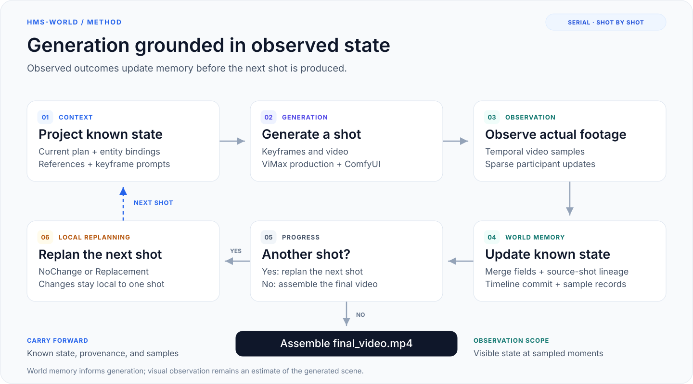

# hms-world：面向多镜头视频生成的可更新世界记忆

[English](README.md) · [简体中文](README.zh-CN.md) · [文档索引](docs/README.md)

**面向多镜头视频生成的世界记忆框架。** hms-world 从实际生成的视频中观察状态变化，维护结构化世界记忆，并将记忆用于后续镜头的参考图选择、关键帧提示词构建与下一镜重规划。

[News](#news) · [Highlights](#highlights) · [Overview](#overview) · [核心代码](#core-codes) · [快速开始](#quick-start) · [实验结果](#benchmark-结果) · [TODO](#todo)

<a id="news"></a>

## 🔥 News

* **`2026.11.05`** 🤗 我们发布 **hms-world**，提供面向多镜头视频生成的世界记忆框架、**CLI / Web / TUI** 工作流、[三镜示例](examples/serial_demo_three_shot.txt)及[历史评测结果](#benchmark-结果)。
* **`2026.10.29`** ✅ 完成 ViMax baseline 已运行子集的评分，覆盖 **4/35 个故事、42 个镜头**。[同案例分数与元数据](evals/results/vimax-baseline-partial-20261029.json)已提供。
* **`2026.10.22`** ✅ 完成 **ViMax-Bench** 历史开发批次评分，覆盖 **35 个故事、437 个镜头**。详见[逐故事分数与实验条件](evals/results/vimax-bench-20261022.json)。

<a id="highlights"></a>

## 🎯 Highlights

- **可更新的世界记忆：** 为人物、道具和场景分配稳定实体 ID，在统一 Timeline 上维护已知状态。
- **基于实际画面的状态更新：** 从生成视频中提取稀疏状态变化，逐字段合并至已有记忆。
- **来源驱动的参考材料选择：** 将状态字段关联到历史镜头，为关键帧生成选择相关视觉材料。
- **下一镜局部重规划：** 结合观察结果与机位约束，保留或修订下一镜方案。
- **统一的制作入口：** CLI、Web、TUI 与评测共享串行生产流程，支持计划审阅和检查点恢复。

🌟 **基于 ViMax 扩展：** hms-world 沿用 [ViMax](https://github.com/HKUDS/ViMax) 的角色图、分镜、机位转场与单镜制作能力，加入持续更新的“观察—记忆—生成”闭环。

<a id="overview"></a>

## ✨ Overview

<p align="center">
  <a href="docs/diagrams.md#generation-loop">
    
  </a>
</p>

> **TLDR：** hms-world 从生成画面中构建世界记忆，通过参考图选择、关键帧提示词与局部重规划，将观察到的状态传递至后续镜头。

[查看完整图示](docs/assets/world-memory-loop.svg) · [系统架构图](docs/diagrams.md#system-architecture) · [连续性说明](docs/continuity.md)

剧本描述预期动作，生成视频反映实际可见结果。例如，剧本要求人物将杯子放到桌上，实际画面却仍显示人物持杯；后续制作需要依据这一状态判断原计划是否适用。hms-world 将叙事目标与视觉观察分别建模，通过持续更新的记忆连接相邻镜头。

<details>
<summary><strong>🎬 视频示例（点击展开）</strong></summary>

https://github.com/user-attachments/assets/e0079784-4056-43c4-aa20-bb1d985bc648

</details>

<a id="method"></a>

<details>
<summary><strong>方法细节：状态、观察、检索与重规划（点击展开）</strong></summary>

### 1. 实体状态表示与统一时间轴

实体登记为人物、道具和场景分配稳定 ID。Timeline 按故事顺序组织镜头：待执行位置保存计划，已观察位置保存合并后的完整已知状态。执行当前镜头前，系统将此前已知状态投影至本镜参与实体，形成制作上下文。

人物状态包含服装、表情、情绪、姿势、位置、朝向及持有的登记道具；道具状态包含位置与物理状况；场景状态包含可见布置及其变化。机位信息限定于当前镜头，不自动继承至下一镜。

### 2. 视觉观察与稀疏状态合并

Observer 读取由实体参考和时序采样帧组成的 3×4 图板，必要时可请求最多两轮原尺寸采样帧检查。其输出描述末次采样时刻的已观察状态，范围限定于当前镜头的参与实体。Observer 不接收动作计划；计划与实际结果的比较由后续 Replanner 完成。

Timeline 按以下语义应用稀疏更新：

| 更新形式 | 合并语义 |
| --- | --- |
| 省略字段 | 保留原有已知值 |
| 字段显式为 `null` | 清除原有字段值及其来源 |
| `holding: []` | 确认未持有本镜登记道具，覆盖原有持物列表 |
| 非空字段值 | 写入新值；值发生变化时更新来源 |

未参与本镜的实体保留其已知状态。由此，模型负责局部观察，Timeline 负责累积状态的维护。

### 3. 字段来源与历史视觉材料选择

对于观察后形成的非空字段，系统记录其首次出现或最近变化的镜头编号；值未变化时保留原来源，字段被清空时移除来源。该来源索引用于将结构化记忆关联至历史视频采样。

当前历史候选构建路径依据**本镜绑定道具的字段来源**定位历史镜头，每个来源镜头提供末张采样和一张可复现的随机采样。Selector 结合历史候选、人物身份图及 ViMax 原生机位参考，为当前首帧或尾帧选择材料：每个可见人物选取一张身份图；生成尾帧时，本镜实际首帧为必需材料。FramePromptWriter 据此结合当前目标与已知状态，构建最终关键帧绘图提示词。

字段来源的粒度为镜头级，具体采样帧对某一字段的支持程度仍需依据可见内容判断。历史图仅用于其中实际可见、且与当前任务相关的连续性信息。

### 4. 基于实际结果的下一镜重规划

Replanner 接收上一镜剧本、合并后的完整已知状态、最后一张实际采样图，以及下一镜计划和机位约束，输出 `NoChange` 或 `Replacement`。调整范围限定于下一镜；替换后的计划继续执行相同的材料选择、生成与观察流程。

状态模型、字段来源、材料选择及恢复规则详见[连续性状态与视觉材料](docs/continuity.md)。

</details>

<a id="core-codes"></a>

## 💥 核心代码与支持的后端

串行制作闭环的核心实现在 [`pipelines/serial_demo_pipeline.py`](pipelines/serial_demo_pipeline.py)，主要组件如下：

| 组件 | 代码位置 |
| --- | --- |
| 串行制作与恢复 | [`pipelines/serial_demo_pipeline.py`](pipelines/serial_demo_pipeline.py) |
| Timeline 与状态合并 | [`continuity/timeline.py`](continuity/timeline.py) |
| 视觉观察 | [`agents/shot_observer.py`](agents/shot_observer.py) |
| 连续性参考图选择 | [`agents/continuity_image_retriever.py`](agents/continuity_image_retriever.py) |
| 关键帧提示词构建 | [`agents/frame_prompt_writer.py`](agents/frame_prompt_writer.py) |
| 下一镜重规划 | [`agents/shot_replanner.py`](agents/shot_replanner.py) |
| 交互运行时 | [`agent_runtime/`](agent_runtime) |
| 评测生成与评分 | [`evals/vimax/`](evals/vimax) |

仓库提供 ComfyUI [FLUX](tools/image_generator_comfy_flux.py) 与 [Qwen](tools/image_generator_comfy_qwen.py) 图像适配器，以及 [H3 视频适配器](tools/video_generator_comfy_h3.py)。对话和视觉理解使用 OpenAI 兼容接口。

### 默认配置

当前示例配置与评分设置如下。历史批次的生成条件以对应结果文件为准。

| 组件 | 模型 / 服务 | 参数 |
| --- | --- | --- |
| 对话、规划与视觉理解 | Qwen3-VL-30B-A3B | temperature 0.7，top_p 0.8，max_tokens 8192 |
| 图像生成 | ComfyUI FLUX.2 klein 9B Base | 50 steps，CFG 4.0 |
| 视频生成 | ComfyUI H3 | 1280×720，5 秒，首帧 / 首尾帧条件 |
| 一致性评分 | ViCLIP-L-14 / InternVid-10M-FLT | 8 帧，224×224，float32 |

生成风格由任务指定，上述评测批次使用 `realistic live action`。服务地址与 H3 工作流路径通过[串行示例配置](configs/serial_demo_local_h3.example.yaml)设置。

<a id="architecture"></a>

<details>
<summary><strong>系统架构、制作产物与检查点恢复（点击展开）</strong></summary>

系统由 Python 生产核心、Web/TUI 交互层及文件检查点组成。各入口共享串行制作流程，每镜完成生成、观察与状态提交后，再推进下一镜。

[查看完整系统架构图 →](docs/diagrams.md#system-architecture)

Web 的 Node 服务和 TUI 通过子进程与 Python Agent 交换 JSONL 事件，Web 通过 SSE 向浏览器传递进度。对话与视觉理解采用 OpenAI 兼容模型接口，生成服务通过本地回环地址接入。

每次制作保存实体登记、`continuity/timeline.json`、图片记录、逐镜媒体和采样清单。恢复时校验检查点与实际文件，再继续尚未完成的制作。交互入口支持先审阅文本计划、再按请求渲染；修订计划会创建新会话并保留原计划与媒体。产物目录与恢复机制见[串行生成架构](docs/architecture.md)。

</details>

<a id="installation"></a>
<a id="preparation"></a>

## 🛠 环境准备

需要 **Python 3.12+**、**uv** 和 **FFmpeg**。使用 Web/TUI 还需 Node.js 与 npm，建议使用 Node.js 22。

**1. 克隆仓库并安装 Python 依赖。**

```sh
git clone https://github.com/Shadow-Weave/HMS-World.git hms-world
cd hms-world
uv sync --locked --python 3.12
```

后续命令均从仓库根目录执行。

**2. 配置本地推理服务。**

```sh
cp configs/serial_demo_local_h3.example.yaml configs/serial_demo_local_h3.yaml
```

单独部署支持图像输入的 OpenAI 兼容模型服务、ComfyUI 图像服务与 ComfyUI H3 视频服务，并按实际部署修改配置：

| 配置项 | 用途 |
| --- | --- |
| `chat_model.init_args` | 支持图像输入的模型名称、地址与认证信息 |
| `image_generator.init_args.base_url` | ComfyUI 图像服务地址；示例使用 FLUX.2 klein |
| `video_generator.init_args.base_url` | ComfyUI H3 视频服务地址 |
| `video_generator.init_args.workflow_path` | 本机 H3 API 工作流 JSON 的实际路径 |

> **💡 配置说明：** 保留 `local_only: true` 并使用回环地址。远程服务可通过 SSH 转发接入。运行前请替换 `/path/to/workflow-api.json` 占位路径。

**3. 准备交互配置（用于 Web/TUI）。**

```sh
cp configs/agent.example.yaml configs/agent.local.yaml
```

将 `serial.config` 指向同一份串行 YAML，或用 `HMS_WORLD_SERIAL_CONFIG` 指定。对话默认复用其中的 `chat_model`；可选 `llm` 设置只覆盖对话模型。图像、视频和连续性组件使用串行配置。

<a id="quick-start"></a>

## 🎬 快速开始

### 串行三镜生成

```sh
.venv/bin/python main_serial_demo.py \
  --config configs/serial_demo_local_h3.yaml \
  --script-file examples/serial_demo_three_shot.txt \
  --user-requirement-file examples/serial_demo_three_shot_requirements.txt \
  --style "3D CGI animation" \
  --output .working_dir/serial_demo
```

产物保存在 `.working_dir/serial_demo/`，Timeline 检查点位于 `continuity/timeline.json`。成功结束时输出合成视频路径。

<details>
<summary><strong>恢复已有制作任务（点击展开）</strong></summary>

使用原配置、风格与输出目录，增加 `--resume`，不再传入剧本和制作要求。

```sh
.venv/bin/python main_serial_demo.py \
  --config configs/serial_demo_local_h3.yaml \
  --style "3D CGI animation" \
  --resume \
  --output .working_dir/serial_demo
```

</details>

### Web 工作区

```sh
npm --prefix web ci
./hms-world web
```

访问 `http://127.0.0.1:4173`。界面支持项目会话、文件上传、分镜与媒体预览、渲染进度和串行配置；构建与服务选项见 [Web 使用说明](web/README.md)。

### 终端界面

```sh
npm --prefix ui ci
./hms-world tui
```

<details>
<summary><strong>交互计划与会话命令（点击展开）</strong></summary>

计划阶段保存可审阅文本和 Timeline；渲染阶段从 `.working_dir/<session_id>/serial/` 的时间轴恢复。修订会创建新会话并保留原计划与媒体。

```sh
# 新建会话
./hms-world tui new
# 恢复指定会话
./hms-world tui resume <session_id>
```

旧 Idea/Novel/Script 会话仍可查看；重新制作时请新建串行会话并提供确认后的故事文本。项目环境变量统一使用 `HMS_WORLD_*` 前缀。

</details>

<a id="evaluation"></a>

## 🚀 评测运行

无需调用模型即可检查内置 **ViMax-Bench** 数据：

```sh
.venv/bin/python evals/vimax/runner.py --list
.venv/bin/python evals/vimax/runner.py 29 --validate-only
```

生成服务配置完成后，可通过共享串行流程运行一个评测故事：

```sh
.venv/bin/python evals/vimax/runner.py 29 --execute
```

批量生成、续跑与评分方式见[评测说明](evals/README.md)。ViCLIP 评分需单独准备模型与运行环境。开发检查命令见[开发指南](docs/development.md)。

<a id="benchmark-结果"></a>
<a id="benchmark-results"></a>

## 📊 Benchmark 结果

### 评测协议

ViMax-Bench 包含 **35 个故事、437 个镜头**。当前评测适配器使用数据集提供的 `first_frame` 与 `video_prompt` 作为逐镜输入，调用共享生产流程完成生成；一致性评分采用独立入口。数据适配与运行方式见[评测说明](evals/README.md)。

评分采用 **ViCLIP-L-14 / InternVid-10M-FLT** 视频特征的余弦相似度。每镜采样 8 帧，缩放为 224×224，采用 RGB ImageNet 归一化；场景分组沿用数据集的 `scene_num`。

| 指标 | 定义 |
| --- | --- |
| IC ↑ | 同一官方场景内不同镜头对的平均相似度 |
| CC ↑ | 不同官方场景之间镜头对的平均相似度 |
| GC ↑ | 全部不同镜头对的平均相似度 |

各指标均排除镜头自身配对，先计算逐故事分数，再对故事等权平均；表格保留四位小数。这些指标衡量视觉相似性，对动作完成率、物理状态正确性与叙事质量的评价仍需独立验证。

### 完整历史开发批次

以下结果于 **2026-10-20 至 2026-10-22** 完成评分。该开发批次包含逐镜外部视觉审阅、重试、提示词与代码调整及部分案例重启；图像模型在运行期间由 Qwen 迁移至 FLUX，并保留了已完成产物。表中结果对应这一历史开发过程，当前代码版本与默认配置尚未在全部 35 个故事上重新运行。

| 分组 | 故事数 | IC ↑ | CC ↑ | GC ↑ |
| --- | ---: | ---: | ---: | ---: |
| **Overall** | **35** | **0.6264** | **0.6075** | **0.6132** |
| Type A | 12 | 0.5077 | 0.4853 | 0.4902 |
| Type B | 12 | 0.7135 | 0.7152 | 0.7152 |
| Type C | 11 | 0.6608 | 0.6231 | 0.6360 |
| Medium（2 个场景） | 12 | 0.6374 | 0.6130 | 0.6238 |
| Long（3–4 个场景） | 23 | 0.6206 | 0.6046 | 0.6076 |

[逐故事分数与评测元数据](evals/results/vimax-bench-20261022.json)包含评分源码版本、权重 SHA256、模型迁移记录和汇总口径。公开导出提供分数与元数据，原始视频及完整运行日志未随仓库发布。评分实现见 [`score.py`](evals/vimax/score.py)。

### ViMax baseline：同案例子集比较

ViMax baseline 当前完成 **4 / 35 个故事**，于 **2026-10-29** 评分，包含案例 **1、13、17、19**，共 **42 个镜头**（Type A 1 个故事、Type B 3 个故事）。

Baseline 使用 ViMax 原生规划与制作流程（上游版本 `fd4b72e`），接入本地模型适配器，不启用 hms-world 的 Observer、Timeline 连续性闭环与 Replanner。官方故事及逐镜描述交由原生流程规划；评分采用相同的 ViCLIP 配置与 `scene_num` 分组。

下表比较**相同 4 个故事**，hms-world 分数取自上述历史开发批次的对应案例，均按故事等权平均。

| 方法 | 对比故事数 | IC ↑ | CC ↑ | GC ↑ |
| --- | ---: | ---: | ---: | ---: |
| ViMax baseline（部分完成） | 4 | 0.6798 | 0.6812 | 0.6807 |
| hms-world（相同案例） | 4 | 0.6888 | 0.6951 | 0.6927 |

| 案例 | 类型 | Baseline GC ↑ | hms-world GC ↑ |
| --- | --- | ---: | ---: |
| 1 · chef_international_kitchens | Type A | 0.5884 | 0.5804 |
| 13 · investigation_antique_bookshop | Type B | 0.7324 | 0.7397 |
| 17 · family_gathering_victorian_mansion | Type B | 0.6794 | 0.7244 |
| 19 · science_demo_university_lab | Type B | 0.7228 | 0.7262 |

两组结果来自各自的历史批次，生成与审阅条件存在差异；该子集比较的结论范围限于已完成案例。完整 35 故事的同条件 baseline、单变量消融及重复随机种子的置信区间尚未报告。[Baseline 逐故事分数与对照元数据](evals/results/vimax-baseline-partial-20261029.json)提供完整 IC、CC、GC 及上游版本。

<a id="todo"></a>

## 📋 TODO

以下区分已实现能力与后续研究方向；未勾选条目表示待完成工作。

- [x] 串行视觉观察、Timeline 状态更新、字段来源追踪与下一镜重规划。
- [x] CLI/Web/TUI 共享生产流程、文本计划审阅与检查点恢复。
- [x] ViMax-Bench 适配、一致性评分与历史结果导出。
- [ ] 在一致的生成与审阅条件下完成 35 个故事的 baseline。
- [ ] 使用单一固定模型配置重新评测当前版本。
- [ ] 增加多随机种子实验、置信区间，以及观察、检索和重规划的受控消融。
- [ ] 在视觉相似度之外评价动作完成率与物理状态正确性。
- [ ] 扩展面向更长叙事的历史检索与索引。
- [ ] 探索自动重拍与多镜头联合重规划。

<a id="limitations"></a>

## 📝 局限性

- **观察可靠性**：Observer 可能误读画面，稀疏采样可能遗漏短时变化。字段来源支持状态追溯，状态准确性仍取决于视觉观察。
- **生成可控性**：参考图与结构化状态无法保证生成模型严格遵循约束，人物重复、空间关系错误及历史构图干扰仍可能出现。
- **历史访问范围**：当前候选构建依赖本镜绑定道具的字段来源；任意早期剧情检索及大规模长历史索引尚未实现。
- **规划范围**：Replanner 仅作用于下一镜，当前不支持自动重拍或多镜连锁改写。
- **实验覆盖**：历史开发干预、部分 baseline 及缺少重复实验限制了结果的归因与泛化，后续仍需同条件完整评测及针对动作、状态和叙事的独立评价。

<a id="acknowledgments"></a>

## 👍 致谢

hms-world 基于 [HKUDS/ViMax](https://github.com/HKUDS/ViMax) 继续开发，沿用其角色图、分镜、机位转场和单镜制作能力，并保留对应的上游来源说明。本项目的主要扩展为串行视觉观察、世界状态记忆、历史材料选择与下一镜重规划。

感谢上游项目及相关开源模型与工具的贡献。

<a id="license"></a>

## 📄 许可

代码采用 [MIT License](LICENSE)，保留原始许可声明。
