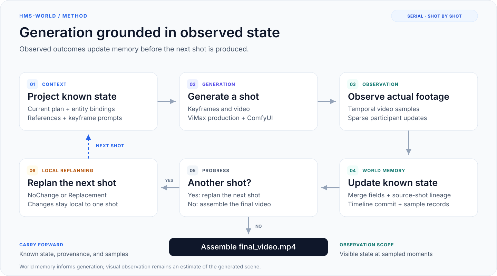
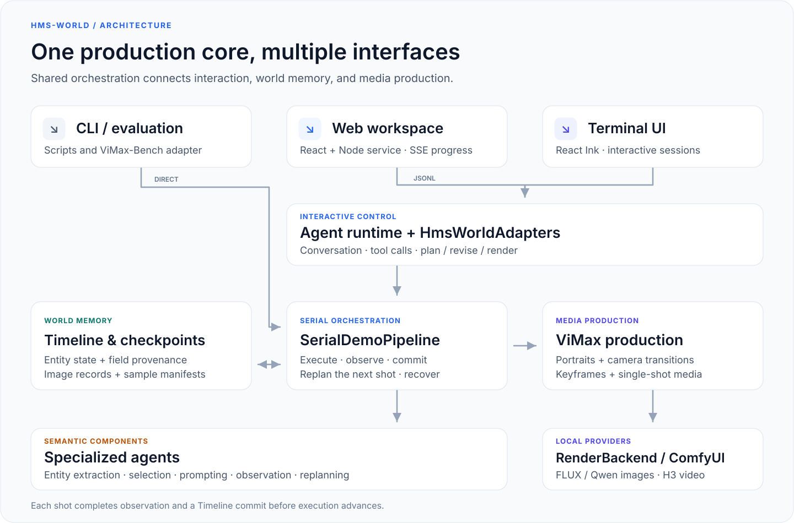

# Diagrams / 流程图

[English overview](../README.md) · [中文说明](../README.zh-CN.md) · [Documentation index](README.md)

The figures below summarize the implemented serial workflow. Open either SVG for a larger view; text and connectors remain sharp when zoomed.

下列图示概括当前已实现的串行工作流。点击图示可打开独立 SVG，放大查看文字与连线。

## Generation loop

[Open full-size SVG / 查看完整 SVG](assets/world-memory-loop.svg)

1. **Project context:** bind the current shot's entities, project known state, select visual references, and write keyframe prompts.
2. **Generate:** produce the current shot's keyframes and video through the shared production pipeline.
3. **Observe:** sample the generated video and extract sparse, participant-scoped state updates.
4. **Update memory:** merge known fields and maintain source-shot provenance and sample records.
5. **Check progress:** assemble the video after the last shot; otherwise continue to replanning.
6. **Replan locally:** retain or replace the next shot, then repeat with refreshed context.

生成过程依次完成状态投影、当前镜制作、实际视频观察和记忆更新。若仍有后续镜头，则重规划下一镜并继续循环；全部镜头完成后按故事顺序合成视频。

Field provenance identifies a source shot. Each sampled image supports only what is visible at its sampled time. See [state and visual-material semantics](continuity.md) for the implementation details.

字段来源定位到历史镜头，具体采样帧的支持范围取决于其可见内容。状态与材料选择语义见[连续性说明](continuity.md)。

## System architecture

[Open full-size SVG / 查看完整 SVG](assets/system-architecture.svg)

| Layer | Responsibility |
| --- | --- |
| Interfaces | Web/TUI exchange JSONL with the interactive runtime; CLI/evaluation call serial production directly |
| Interactive runtime | Agent conversation, tool calls, and `HmsWorldAdapters` for planning, revision, and rendering |
| Serial orchestration | `SerialDemoPipeline` coordinates shot execution, observation, state commits, and next-shot replanning |
| World memory | `continuity/` maintains the Timeline, field provenance, image records, and checkpoints |
| Specialized agents | Entity extraction, reference selection, keyframe prompting, observation, and replanning |
| Production and providers | ViMax-derived production and `RenderBackend` use ComfyUI image/video services |

Web/TUI 通过交互运行时进入串行流程；CLI 与评测入口直接调用串行生产。Timeline 维护状态，专用 Agent 执行语义处理，生产层与 Provider 完成媒体生成。完整模块职责、产物和恢复规则见[架构说明](architecture.md)。
